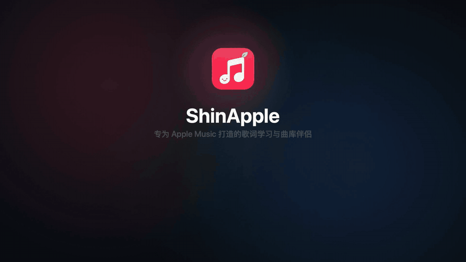
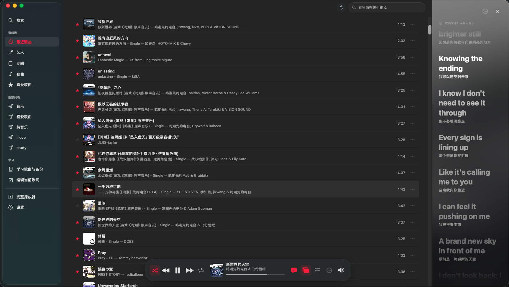
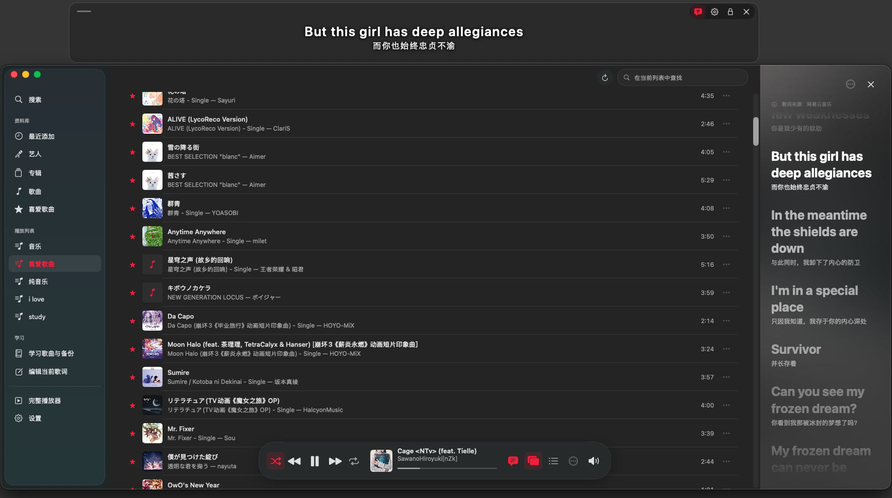
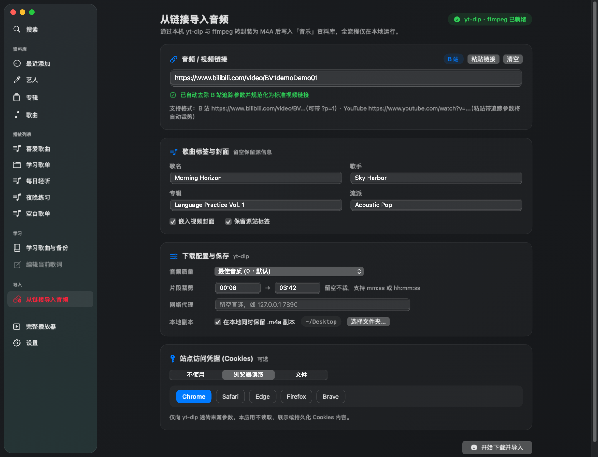
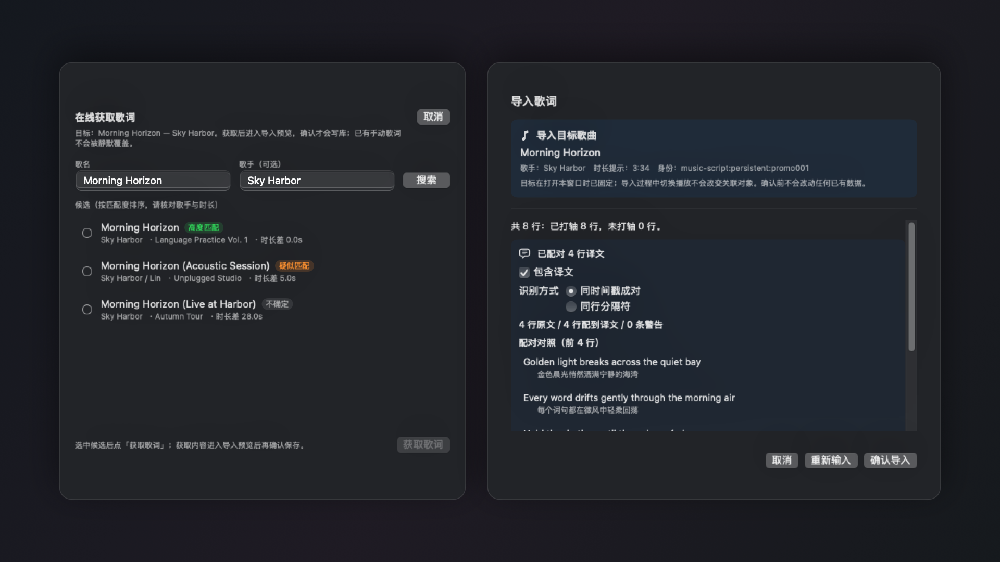

<p align="center">
  
</p>

<h1 align="center">ShinApple</h1>

<p align="center">
  <strong>专为 Apple Music 打造的 macOS 双语歌词学习、桌面悬浮词与链接音频入库伴侣</strong>
</p>

<p align="center">
  <a href="https://github.com/paintstar/apple-music-custom-lyric/releases/tag/v0.1.4"></a>
  <a href="https://github.com/paintstar/apple-music-custom-lyric/releases/tag/v0.1.4"></a>
  
  <a href="#隐私与技术架构"></a>
</p>

<p align="center">
  <a href="#功能预览">功能预览</a> ·
  <a href="#痛点对比">痛点对比</a> ·
  <a href="#核心场景">核心场景</a> ·
  <a href="#30-秒上手">30 秒上手</a> ·
  <a href="#隐私与技术架构">隐私与技术架构</a>
</p>

---

官方「音乐」App 负责账号、订阅与音频播放，**ShinApple** 以原生 SwiftUI + AppKit 构建，提供资料库浏览与播控、双语同步歌词、桌面置顶悬浮词、网易云配词、本地 LRC 精修备份，以及通过本机 `yt-dlp` 与 `ffmpeg` 将音视频链接一键封装为 `.m4a` 导入资料库的能力。所有学习资料与歌词缓存均只保存在本机。

## 功能预览

<p align="center">
  
</p>

<p align="center">
  完整 1080p 宣传视频（34 秒，含配乐）：
  <a href="assets/shinapple-promo.mp4">仓库内观看（<code>assets/shinapple-promo.mp4</code>）</a> ·
  <a href="https://github.com/paintstar/apple-music-custom-lyric/releases/download/v0.1.4/shinapple-promo.mp4">GitHub Release v0.1.4 下载 MP4</a>
</p>

## 痛点对比

为什么选择 ShinApple？

| 核心维度 | 单独使用官方「音乐」App | 搭配 ShinApple（v0.1.4） |
|---|---|---|
| **双语歌词同步对照与精听** | 原生仅支持部分曲库单语滚动歌词，自定义双语对照与外部导入不便 | 原文 + 中文译文逐句高亮对照；长前奏/间奏三点等待进度；点击任意时间轴歌词直达重听，支持阅读挂起与自动恢复跟随 |
| **桌面置顶悬浮歌词** | 无原生独立桌面悬浮歌词窗 | 置顶显示当前双语歌词，主窗最小化/关闭仍同步；锁定后正文鼠标穿透（全屏工作或窗口切换不遮挡），悬停 3 秒（可调）即现解锁入口；支持多屏坐标校正防漂移 |
| **B 站 / YouTube 音频一键转 M4A 入库** | 需手动命令行下载、转换封面标签并拖入资料库，路径与参数易出错 | 内置「导入 → 从链接导入音频」主页面，自动裁剪追踪参数、填写标签并嵌入封面，通过本机 `yt-dlp` + `ffmpeg` 转封装 `.m4a` 后经公开脚本直接写入「音乐」资料库 |
| **网易云歌词匹配与歌单自动获取** | 无第三方歌词匹配、译文配对或歌单监听拉取能力 | 按歌名/歌手搜索并排除明确标注的伴奏版本，同分按时长差精确排序并预览译文配对行数；可选监听指定播放列表成员变化自动获取，不确定的匹配交由用户确认 |
| **本地打轴微调、单句复读与打包备份** | 无行级时间编辑、用户毫秒偏移补偿与跨机备份导出 | 支持直接编辑原文/译文/行时间与歌曲延迟偏移，点击歌词单句跳转重听；提供 LRC 导出与带冲突预览的原子 JSON 完整备份恢复，缓存资源可搜索与按项清理 |

## 核心场景

### 01. 原生资料库协同与双语逐句精听

<p align="center">
  
</p>

- **原生资料库联动**：侧栏直接浏览官方「音乐」中公开脚本可访问的最近添加、艺人、专辑、歌曲、喜爱歌曲（「喜爱歌曲」直接使用 Music 返回的真实播放列表）及各级播放列表；支持在当前列表中即时检索，歌单可按歌名、艺人、专辑、添加时间或时长排序及反转顺序并按歌单记忆偏好。
- **双语歌词与单句点击重听**：右侧歌词栏与独立完整/紧凑播放器同步呈现原文与已有中文译文；较长前奏与标记空白间奏以三点按权威播放进度填满；点击任意已打轴歌词即可跳转到该句精听。
- **自然阅读保护与底栏浮控**：手动滚动、拖动或选词时自动挂起跟随，停止阅读后默认空闲 10 秒恢复同步（可在设置中调整为 2–60 秒）；底栏悬浮胶囊集成播放控制、随机/循环、音量、当前播放列表查看及悬浮歌词总开关，并支持菜单栏「控制」「显示」快捷操作。

### 02. 桌面置顶悬浮歌词窗（鼠标穿透 & 悬停解锁）

<table>
  <tr>
    <td width="64%" align="center" valign="top">
      
      <br />
      <sub><strong>主场景协同：</strong>主窗口与顶部置顶悬浮歌词实时联动，最小化或关闭主窗后仍随音乐播放持续更新</sub>
    </td>
    <td width="36%" align="center" valign="top">
      
      <br />
      <sub><strong>独立浮窗细节：</strong>支持边角缩放、正文拖拽、滚轮阅读长句、锁定穿透与快捷控制按钮</sub>
    </td>
  </tr>
</table>

- **跨应用置顶与全屏友好**：独立悬浮窗由应用级控制器持有，不增加额外数据库读取，主窗最小化或关闭后仍保持逐句同步；不进入独立全屏，适配在桌面或其它工作窗口上方辅助对照。
- **锁定鼠标穿透与悬停解锁**：未锁定时可直接抓住歌词正文拖动位置、拖拽边缘或四角缩放窗口并记住位置，滚轮可阅读长句；点击锁定后整窗正文进入系统级鼠标穿透，默认鼠标悬停 3 秒（可在设置中调整）出现解锁按钮，底栏与应用菜单也可随时解锁。
- **多屏记忆防漂移与齿轮快捷菜单**：窗口位置按当前显示器可见区域校验，已针对 Mac 熄屏唤醒或显示器重连过渡帧优化，防止置于屏幕边缘的悬浮窗被推向中间并覆盖已保存坐标；浮窗深色不透明齿轮菜单集成切歌、音量、当前播放列表、时间偏移、在线获取/手动导入直达及与主设置实时同步的字号/字间距调节。

### 03. 从 B 站 / 音视频链接一键转 M4A 入库

<p align="center">
  
</p>

- **独立主页面与多来源依赖探测**：通过侧边栏「导入 → 从链接导入音频」、播放器导航菜单或「显示」菜单 `⌘⇧I` 进入全宽单列纵向界面；自动探测本机 `/opt/homebrew/bin`、`/usr/local/bin`、`~/.local/bin` 及系统 `PATH` 中的 `yt-dlp` 与 `ffmpeg`（无论通过 Homebrew、`pipx`/`pip`、MacPorts/Conda 还是官方独立二进制安装均可自动识别），缺失时在页面内提供自适应安装命令与一键复制/打开终端引导。
- **链接清洗与平台格式校验**：支持直接粘贴含分享文案的文本，自动提取链接并裁剪 B 站（`/video/BV...`，保留分 P 参数 `p=`）及 YouTube 等追踪参数，对非具体视频页实时给出格式提示。
- **完整封装与安全落盘**：可选填写歌名、歌手、专辑、流派并一键勾选嵌入视频封面与保留源站标签；支持音频质量档位、首尾时间片段裁剪（`mm:ss` / `hh:mm:ss`）、网络代理、Cookies 透传来源点选（支持 Chrome / Safari / Edge / Firefox / Brave 或选择 `cookies.txt` 文件）以及在本地指定目录同时保留 `.m4a` 副本；写入「音乐」后可直接串联网易云搜歌词或导入本地歌词，若「音乐」未开启“拷贝文件到媒体文件夹”，暂存音频会安全保留在 `~/Library/Application Support/ShinApple/ImportedAudio/` 以防断链。

### 04. 网易云智能配词、歌单自动获取与本地备份

<p align="center">
  
</p>

- **多候选精确匹配与人工优先**：搜索默认回填歌名和歌手并去除末尾圆/方括号附注；候选列表保留完整版本名并排除明确标注的伴奏/Instrumental 版本，同分时按未舍入时长差从小到大排序；预览页明确提示译文配对行数、来源未提供译文或收到译文但未能配对，**确认前绝不写入本地库，已导入或编辑的人工成果永不被静默覆盖**。
- **播放列表自动获取与待确认队列**：可在设置中勾选播放列表，按成员变化自动拉取新歌歌词并标注「自动获取，未核对」，不确定匹配进入待确认列表交由用户复核；移出全部已选播放列表时，仅清理未人工编辑且不含人工翻译的自动文档。
- **可迁移本地数据与缓存资源管理**：设置页「本地数据」划分保存位置、本地歌词资源与备份导出；支持自定义库目录切换、单/批量与未关联歌词清理、通用 LRC 导出，以及包含原文/译文/偏移/关联/来源注记并在恢复前提供冲突预览的原子 JSON 备份。

## 30 秒上手

1. **下载安装包**
   前往 [GitHub Releases (`v0.1.4`)](https://github.com/paintstar/apple-music-custom-lyric/releases/tag/v0.1.4) 下载 `ShinApple-0.1.4-macOS-arm64.dmg`（打开后将 **ShinApple** 拖入 **Applications**）或同名 `.zip` 安装包。
   - **系统要求**：**macOS 14.0 及以上**，当前发布 **Apple Silicon（arm64）** 版本，暂未提供 Intel 安装包（最低部署目标不代表所有系统版本和硬件均已实测）。
   - **签名说明**：当前发布包采用 **ad-hoc 签名，未经 Apple 公证**；若系统提示无法验证开发者，请确认下载来源后参照 [Apple 官方说明](https://support.apple.com/zh-cn/102445) 在「系统设置 → 隐私与安全性」中允许打开。
   - **升级提示**：退出 ShinApple 后用新版替换「应用程序」中的旧版即可，本机学习资料会保留（建议升级前先在设置导出 JSON 备份）。

2. **安装可选依赖（仅使用「从链接导入音频」时需要）**
   若需通过链接下载并封装 `.m4a` 音频，需在本机安装 `yt-dlp` 与 `ffmpeg`。应用不限定安装方式，只要可执行文件位于 `/opt/homebrew/bin`、`/usr/local/bin`、`~/.local/bin` 或系统 `PATH` 中即可自动识别：
   - **方式一：Homebrew（最省心，一行同时安装）**：
     ```bash
     brew install yt-dlp ffmpeg
     ```
   - **方式二：`pipx` / `pip`（Python 环境安装 `yt-dlp`，默认可装入 `~/.local/bin`；仍需另行安装 `ffmpeg`）**：
     ```bash
     pipx install yt-dlp
     # 或：python3 -m pip install --user -U yt-dlp
     ```
   - **方式三：官方独立二进制文件（无需包管理器）**：
     从 [yt-dlp Releases](https://github.com/yt-dlp/yt-dlp/releases/latest) 下载 `yt-dlp_macos`（重命名为 `yt-dlp`）、从 [FFmpeg 官方 macOS 构建页](https://ffmpeg.org/download.html#build-mac) 下载 `ffmpeg`，放入 `/usr/local/bin` 或 `~/.local/bin` 并授予执行权限（例如 `chmod +x /usr/local/bin/yt-dlp /usr/local/bin/ffmpeg`）。
   - **方式四：MacPorts / Conda 等其他包管理器**：
     例如 `sudo port install yt-dlp ffmpeg` 或 `conda install -c conda-forge yt-dlp ffmpeg`（若独立终端外 GUI 启动未继承相应环境变量，可将二进制软链至 `/usr/local/bin` 或 `~/.local/bin`）。

3. **首次运行与自动化授权**
   先在官方「音乐」App 完成登录并准备好音乐资料库，随后启动 ShinApple，按系统提示（或在「系统设置 → 隐私与安全性 → 自动化」）允许 ShinApple 控制 **Music.app**（用于读取可访问资料库与发送公开播放控制命令）。若暂拒绝授权，本地歌词库管理、备份与编辑器仍可正常使用。

## 隐私与技术架构

ShinApple 坚持 **Local-First · Zero Telemetry** 原则：无自建服务端、无账号系统、无云同步、无遥测或公共歌词库上传；严格隔离界面、领域逻辑、SQLite 持久化、Music Apple Events 适配与网络获取边界。完整模块拆分与时序细节见 [架构文档](docs/architecture.md)。

<details>
<summary>📌 关键行为边界、数据保存与时间换算规则（点击展开）</summary>

### 1. 数据保存与备份格式
真实数据默认保存在 `~/Library/Application Support/ShinApple/`（实际位置可在设置页查看与切换）。当前应用未启用 App Sandbox，删除应用不会自动删除本地数据：

| 文件 / 目录 | 内容说明 |
|---|---|
| `lyrics.sqlite` | 歌词、译文、行时间、歌曲关联、偏移和来源版本信息 |
| `lyrics.sqlite-wal` / `lyrics.sqlite-shm` | SQLite 运行期间伴生文件 |
| `lyrics.preopen.json` | 启动时尽力生成的本地快照（不替代独立位置备份） |
| `ImportedAudio/` | 链接导入音频暂存目录；仅当「音乐」未勾选“拷贝文件到媒体文件夹”时保留 `.m4a` 源文件 |

- **保存位置切换**：切到空目录时复制现有资料；切到已有歌词库时直接使用目标库而不合并，旧目录保留供确认后自行清理。自定义路径与界面偏好存于本机 `UserDefaults`。
- **备份与导出差异**：JSON 备份完整保留原文、译文、行时间、来源注记、歌曲关联、偏移和版本信息，恢复前展示冲突预览并原子写入；LRC 导出供其他播放器使用，不写 `[offset:]` 标签且不含译文、行 UUID 与来源信息。当前导入默认上限为 **2 MiB**、**10,000 行**。
- **共享歌词与资源清理**：手动解除最后一个歌曲关联时同步删除对应歌词和译文，仍被其他歌曲共享的文档会保留；设置「缓存资源管理」仅管理当前库的歌词、译文和关联，不删除已导出备份、导入源文件或「音乐」中的音频。迁移与恢复详情见 [数据迁移说明](docs/migration.md)。

### 2. 歌词格式与时间换算规则
- 支持 LRC 时间戳 `[mm:ss]`、`[mm:ss.f]`、`[mm:ss.ff]`、`[mm:ss.fff]` 与 `[mm:ss:ff]`（末尾两位按百分之一秒解析），支持分钟超过 59、单行多时间戳、元信息、`[offset:]`、空歌词时间行、未打轴纯文本及 UTF-8 / UTF-8 BOM / 带 BOM UTF-16 编码（乱序时间会排序并提示）。
- 文件 `sourceOffsetMs` 与用户 `userDelayMs` 独立保存，正用户偏移表示歌词延后，渲染、点击跳转和导出共用统一换算：
  ```text
  生效时间 = 行时间 − 文件 offset + 用户偏移
  ```
- 导出现有偏移后的 LRC 时，负时间将裁剪为 `0` 并显示提示。

### 3. 播放控制、网络与链接导入安全边界
- **Music 自动化**：仅经 `Packages/ShinMusicScript` 调用 Music.app 公开 Apple Events / AppleScript / Scripting Bridge，不使用私有 MediaRemote API，不读取、录制、下载或分发受保护 Apple Music 音频流，也不读取 Apple 官方歌词。播放快照中的位置为权威时间（内部使用整数毫秒，未知为 `nil`），展示层仅允许有上限（默认 1 秒）的单调时钟短时插值。
- **随机与临时管理歌单**：点选歌曲及筛选集合播放仅在需要保持范围与续播时创建/复用「ShinApple · 当前播放」歌单（仅含曲目引用，不改动原歌单或音频）。退出应用默认先停播并仅清理能核实归属且未被用户修改的自有管理清单（最多等待 10 秒，关闭窗口不触发）。
- **歌词关联身份**：歌词文档与歌词行使用稳定 UUID；Music 外部引用带 `music-script:persistent:` 命名空间，不按歌名自动合并，跨机迁移后缺失可靠标识由用户确认。
- **网易云在线获取**：HTTP 请求仅限 `Packages/ShinLyricsProvider`，目标域名集中限定于 `music.163.com` 与 `interface3.music.163.com`，匿名、限速，只查询歌曲信息与歌词文本，不读存登录凭据。该端点并非官方公开 API，可能受网络或内容权限影响失败。
- **链接音频导入**：子进程调用严格限定于 `Packages/ShinAppServices/Sources/ShinAppServices/AudioLinkImportService.swift`，仅以 `Foundation.Process` 参数数组（禁止 shell 拼接）调用本机安装的 `yt-dlp` 与 `ffmpeg`；用户选择的浏览器或 `cookies.txt` 仅透传来源参数/文件路径，应用本身绝不读取、解析、日志输出或持久化 Cookie 内容。
- **当前明确未提供功能**：日语注音、AI 翻译、点词解释、单词本、逐字卡拉 OK、TTML、自动打轴、变速播放、无缝 AB 句子循环、Apple Music 全曲库搜索与账号管理。

</details>

<details>
<summary>🛠️ 源码构建、Mock 演示与本地 CI 检查（点击展开）</summary>

构建需要 **完整 Xcode 26 及以上**、Swift 6、[XcodeGen](https://github.com/yonaskolb/XcodeGen)、[SwiftLint](https://github.com/realm/SwiftLint) 与安全审计所需的 Python 3（`python3`）。详见 [开发者配置](docs/developer-setup.md)。

### 源码构建与运行
```bash
# 生成工程并构建未签名 Debug App（产物位于 .build/xcode/Build/Products/Debug/ShinApple.app）
bash scripts/build.sh Debug --unsigned
open .build/xcode/Build/Products/Debug/ShinApple.app
```

### Mock 演示模式（不发声、不控制 Music、不联网）
```bash
open -n .build/xcode/Build/Products/Debug/ShinApple.app --args --mock
```
Mock 模式使用原创虚构曲目、歌单与歌词，窗口显示「模拟模式」标识，每次启动创建独立临时数据库，不会改动真实歌词库。

### 本地 CI 门槛与 Release 打包
```bash
# 运行六包单元测试、脚本契约检查、App 类型检查、SwiftLint --strict、密钥/出站审计与 Release 编译
bash scripts/ci-local.sh

# 构建带许可证、DMG / ZIP 与 RELEASE-NOTES.md 的分发包（输出至 .build/release/）
bash scripts/package-release.sh
```

</details>

---

### 文档索引与许可证

[架构文档](docs/architecture.md) · [开发者配置](docs/developer-setup.md) · [数据迁移](docs/migration.md) · [依赖与许可证](docs/dependencies.md) · [贡献指南](CONTRIBUTING.md) · [安全策略](SECURITY.md) · [更新记录](CHANGELOG.md)

本项目代码与文档采用 [MIT License](LICENSE)。许可证不覆盖用户自行导入或获取的歌词、翻译、音频及其他第三方内容；使用和分发相关内容请自行确认授权。ShinApple 与 Apple Inc.、网易公司无任何从属关系。
